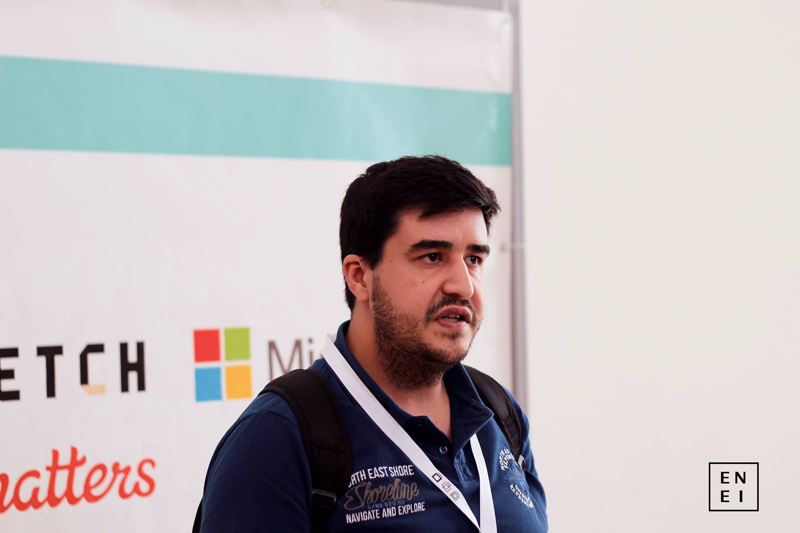
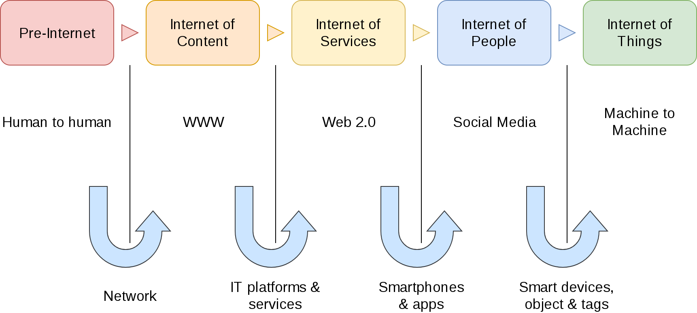
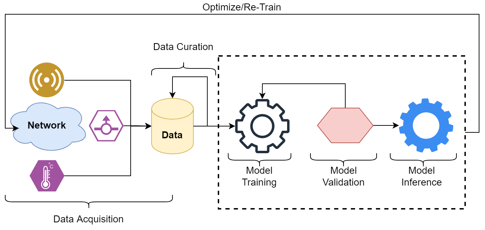

# Class Introduction

## Professor

::: columns

:::: column
- **Name:** Mário Antunes
- **E-Mail:** [mario.antunes@ua.pt](mailto:mario.antunes@ua.pt)
- **Office:** 19.2.15 (IT1)
::::

:::: column

::::

:::

## Class Introduction i

::: columns

:::: column
- Given the evolution of the threats
- And the complexity of the systems
- AI/ML are gaining traction as a usefull tool
::::

:::: column

::::

:::

## Class Introduction ii

## Class Introduction iii

# Evaluation

## Evaluation

- **Discrete (recommended):** 50% theory + 50% practice
  - Theoretical Test 1 (25%): Class 08, 06-11-2026 (Modules 1 and 2: spam and anomaly detection)
  - Theoretical Test 2 (25%): Class 14, 18-12-2026 (Modules 3 and 4)
  - Practical project (50%): released Class 08 (06-11-2026), due Class 14 (18-12-2026)
- **Final:** 50% final exam (*Época Normal*) + 50% project

# Class Schedule

## Class Schedule

| Date       | Class | Topic                              |
|-----------:|------:|:-----------------------------------|
| 18-09-2026 | 1     | Presentation, AI/ML for security   |
| 25-09-2026 | 2     | Spam detection I                   |
| 02-10-2026 | 3     | Spam detection II                  |
| 09-10-2026 | 4     | Spam detection III                 |
| 16-10-2026 | 5     | Anomaly detection I                |
| 23-10-2026 | 6     | Anomaly detection II               |
| 30-10-2026 | 7     | Anomaly detection III              |
| 06-11-2026 | 8     | Test 1 + project kickoff           |
| 13-11-2026 | 9     | Malware analysis I                 |
| 20-11-2026 | 10    | Malware analysis II                |
| 27-11-2026 | 11    | Network intrusion detection        |
| 04-12-2026 | 12    | Generative AI and LLMs in security |
| 11-12-2026 | 13    | Project clinic                     |
| 18-12-2026 | 14    | Test 2 + project presentations     |

# Environment

## Environment

# Bibliography

## Bibliography {.allowframebreaks}

All of the books are available here: [https://learning.oreilly.com/](https://learning.oreilly.com/)
