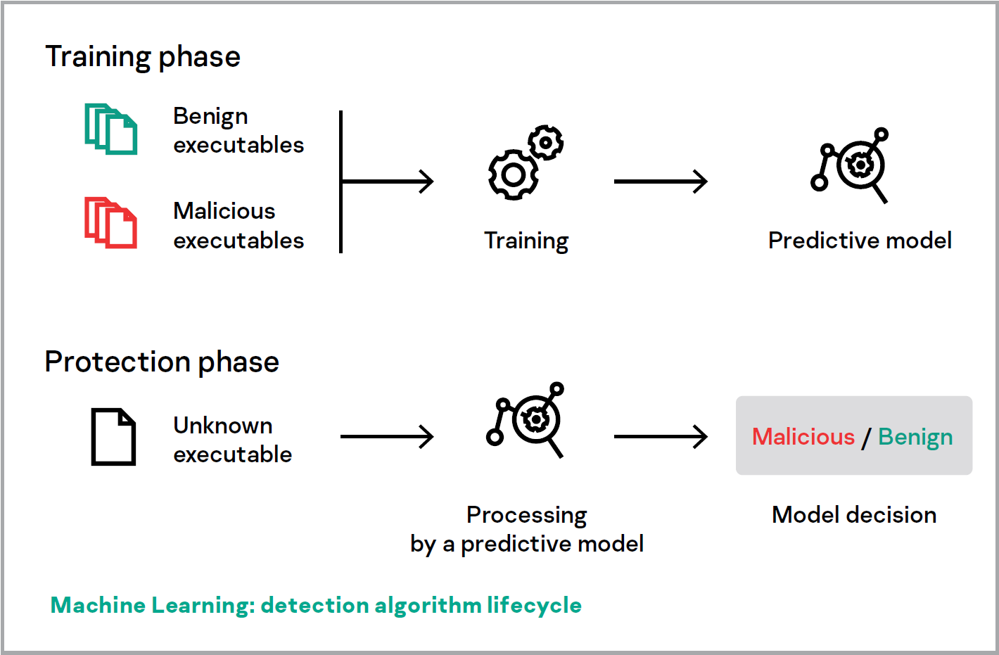
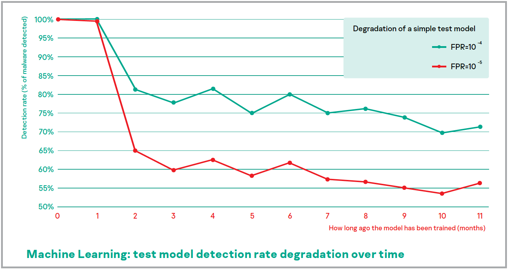
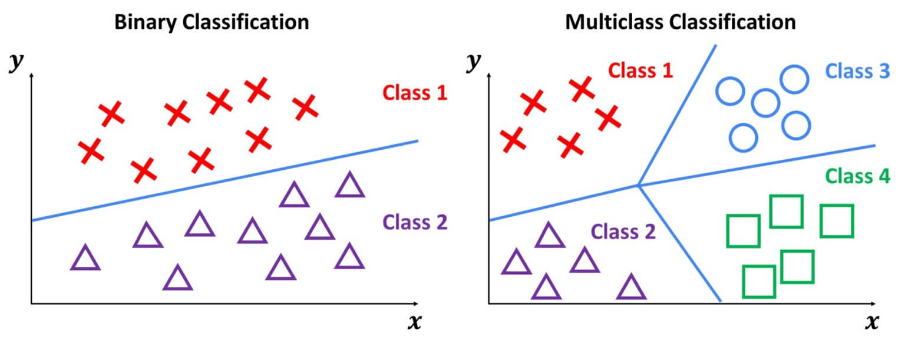

# Malware in Context

## Why detection is a learning problem

* **Malware** is any program built to harm a device, network, server or user.
* The harm ranges from a prank to a continental outage.
* Today's classes: detect it **without** running it, then **with** running it, then break both.

## Creeper virus (1971)

* Written by Bob Thomas in assembly; it hopped between machines on an early network.
* It did no harm: it only printed a taunting message.
* Von Neumann's theory of self-reproducing automata (1966) had predicted the idea.

## ILOVEYOU worm (2000)

* Built to steal passwords so its author could use other people's dial-up accounts.
* It exploited flaws in Windows 95 and reached millions of machines.
* The author was never charged: the act was not illegal in the Philippines then.

## CryptoLocker ransomware (2013)

* Famous for fast spread and strong asymmetric encryption of the victim's files.
* Unusual happy ending: in 2014 police took over the Gameover Zeus botnet.
* Victims' files were restored free of charge; phishing variants still circulate.

## Mirai botnet (2016)

* Took over smart devices, mostly security cameras, with default passwords.
* Built for game-server feuds, it hit a major domain-name provider instead.
* Much of the American east coast lost the internet for a day.

## Clop ransomware (2019 to present)

* Encrypts files and also **steals** the data, to threaten publication.
* Lesson: backups alone no longer end an incident.

# How To Recognize Malware

## Ten ways to recognize malware (1/4)

<!-- defines: static analysis -->

1. **Signatures**: known indicators of compromise; reactive.
2. **Static analysis**: names, hashes, strings and headers; no execution.
3. **Dynamic analysis**: run the sample in a sandbox, watch it.

## Ten ways to recognize malware (2/4)

4. **File watching**: many renames or deletes mean tampering.
5. **Blocklist**: refuse known dangerous file types.
6. **Allowlist**: only approved programs run.

## Ten ways to recognize malware (3/4)

<!-- defines: entropy -->

7. **Honeypot**: a decoy application or file draws attackers in.
8. **Checksum**: detects corruption, not tampering.
9. **Entropy**: packed code looks random.

## Ten ways to recognize malware (4/4)

10. **Machine learning**: learn patterns from labelled files.
* Items 1 to 9 are rules; item 10 generalises.
* Today we build item 10 for items 2 and 3.

## File entropy as a feature

* **Entropy** $H$ of the byte histogram: 0 bits (constant) to 8 bits (random).
* Packed or encrypted sections sit near 8 bits; code sits lower.
* One number per section is a cheap feature; packers add padding.

# Detection Pipeline

## Pre-execution and post-execution data

* **Pre-execution**: file format, code description, byte statistics, strings, emulation.
* **Post-execution**: behaviour and events caused by the running process.
* A scanner may use one phase or both; class 04_02 is the second phase.

## From hand-written rules to learning

* Early malware was rare: manual pre-execution rules were enough.
* Internet growth made rules impractical: new protection technology was needed.
* Today machine learning scores host, network and cloud data.

## Unsupervised and supervised learning

* **Unsupervised**: find structure in unlabelled data; labels by experts are costly.
* **Supervised**: data and right answers are known; fit a model for new objects.
* Two stages: **training** the model, then **applying** it; parameters no longer change.

## The learning pipeline

{width=75%}

* $X$ = features of content or behaviour; $Y$ = benign, malware, or a family.

# Requirements of a Detector

## Deep learning

* Extracts high-level features from low-level data (images, speech, text, bytes).
* Learns feature hierarchies and folds pipeline steps into one model trained end to end.

## Large representative datasets

* The approach is **data-driven**: the model is as good as its data.
* Training data must match the real conditions: a **representative dataset**.

## Interpretability (XAI)

* Deep networks are **black boxes**: input $X$, output $Y$, no human-readable steps.
* After a false alarm we ask: bad training set or bad model?
* **Interpretability** decides how easy it is to manage, assess and correct a model.

## False positives must be rare

* A false positive flags a clean file as malware.
* Optimise for a low false positive rate (FPR).

## Adaptability: data drift

* Usual machine learning assumes a **fixed distribution**; malware does not allow it.
* Adversaries release new versions that differ from training data.
* Software vendors keep producing new benign programs the model must accept.

## Drift in one picture

{width=75%}

* Retrain on schedule; watch the alarm rate.

# Multi-Class and Multi-Label

## Multi-class classification

* One of three or more classes; binary classification has two.

{width=60%}

## One-versus-rest

<!-- defines: one-versus-rest -->

* One binary classifier per class: red vs rest, blue vs rest, green vs rest.
* Predict with the most confident classifier.
* $K$ classes need $K$ models.

## One-versus-one

<!-- defines: one-versus-one -->

* One binary classifier per pair of classes; each votes, the most votes win.
* The number of models is $K(K-1)/2$: 21 for our 7 classes.

## Multi-label classification

<!-- defines: multi-label -->

* A file can carry **several** labels at once.
* One sigmoid output per label; each has its own threshold.
* Multi-class has exactly one label per file; multi-label has zero or more.

## Metrics for many classes

* The $K \times K$ confusion matrix shows which families get mixed up.
* **Macro** F1 averages classes equally; **micro** pools all decisions; **weighted** follows class sizes.
* With rare families report macro F1: accuracy hides them.

# Static Detection

## Detect malware without running it


```{=latex}
\begin{adjustbox}{max width=\linewidth,max totalheight=0.30\textheight,center}
\begin{tikzpicture}
  \node[neu, text width=2.2cm] (f) {file on disk};
  \node[dfn, text width=2.6cm, right=10mm of f] (x) {features\\header fields, API imports};
  \node[dfn, text width=2.2cm, right=10mm of x] (m) {classifier};
  \node[ok, text width=2.2cm, right=10mm of m] (d) {benign / malware};
  \draw[arr] (f) -- (x); \draw[arr] (x) -- (m); \draw[arr] (m) -- (d);
\end{tikzpicture}
\end{adjustbox}
```

* **Static analysis**: score a file without running it.
* Features: 77 Portable Executable (PE) header fields; imported API counts [@ember:2018].

## The data and the metric trap

* 19,611 files, 74.4% malware: the **reverse** of reality.
* Random forest: area under the ROC curve (AUC) 0.9992, F1 0.9941.

| Benign share kept | AUC | F1@.5 |
|:--------------|------:|------:|
| 100% (3,759) | 0.9992 | 0.9941 |
| 20% | 0.9953 | 0.9888 |
| 5% | 0.9893 | 0.9784 |
| 1% (50) | 0.9854 | 0.9584 |

## Imbalance: report an operating point

{width=47%}

* AUC barely moves; precision and the threshold do.
* Best threshold 0.95: precision and recall 0.976.

## Notation: scanner metrics

| Symbol | Meaning | Example |
|:----------------|:---------------------------------|:----------|
| $b$ | share of malware in the queue | 74.4% in the data |
| $\text{TPR}$ | share of malware that raises an alarm | scalar |
| $\text{FPR}$ | share of benign files that raises an alarm | scalar |
| $P(\text{malware}\mid\text{alarm})$ | share of alarms that are malware (precision) | scalar |

## The base rate decides precision

:::: {.columns}
::: {.column width="50%"}
<!-- derivation: the-base-rate-decides-precision-definition -->
$$
\begin{aligned}
P(\text{malware}\mid\text{alarm}) \\
=\frac{\text{TPR}\,b}{\text{TPR}\,b+\text{FPR}\,(1-b)}
\end{aligned}
$$
:::
::: {.column width="50%"}

:::
::::

* Precision falls with $b$, AUC does not: tune on the real queue.

## What the header model looks at

{width=65%}

* Top fields: operating-system and subsystem versions, stack size, linker version.
* These are **metadata the author controls**: class 04_03 rewrites them.

# Families and the Two-Stage Hierarchy

## 20,000 files, 21,918 API columns

* 7 classes: benign and six families (RedLine, Downloader, remote-access trojan (RAT), Banking, Snake, Spyware).
* Density 0.0032: keep it **sparse** (CSR); a dense copy needs gigabytes.
* Spyware and Snake import about 10 to 13 functions, RATs about 79.

## Flat multi-class baseline

* Macro-F1 0.638, accuracy 0.684 on 5,000 held-out files.
* Downloader F1 0.984; **Spyware F1 0.072**: generic calls hide it.

## Two-stage hierarchy

<!-- defines: two-stage hierarchy -->

```{=latex}
\begin{adjustbox}{max width=\linewidth,max totalheight=0.34\textheight,center}
\begin{tikzpicture}
  \node[neu, text width=1.8cm] (f) {API counts};
  \node[dfn, text width=2.6cm, right=9mm of f] (s1) {\textbf{stage 1}\\binary: benign or malware};
  \node[ok, text width=2.0cm, above right=3mm and 9mm of s1] (b) {benign: stop};
  \node[dfn, text width=2.8cm, below right=3mm and 9mm of s1] (s2) {\textbf{stage 2}\\family, only on flagged files};
  \draw[arr] (f) -- (s1); \draw[arr] (s1) -- (b); \draw[arr] (s1) -- (s2);
\end{tikzpicture}
\end{adjustbox}
```

* Stage 2 trains on malware only.

## Flat or hierarchical?

{width=85%}

* End-to-end macro-F1: hierarchy 0.635, flat 0.638: no loss.
* Stage 1: AUC 0.879, F1 0.979.
* Its recall caps the pipeline.

## Making it fast enough to demo

* Read the file in chunks; keep a **sparse** 20,000-file sample.
* Demo times: headers 11 s, families 32 s, sequences 73 s, evasion 32 s.
* **Batching** the forest queries made the evasion demo 6x faster.

## Beyond this dataset

* Raw-byte networks learn from the whole file [@raff:2018].
* EMBER2024: files for several platforms, with evasive samples [@joyce:2025].
* Use it for homework; our demos stay small and fast.

# Limits of Static Analysis

## A replicator has no features

* A worm-like program is ordinary code: no header row.
* Lab: four containers send **data-only** beacons (fan-out 2, hop limit 4).
* Static scan: nothing. Flow log: depth 4. **Behaviour** is the signal.

## Takeaways

* Static header detection is almost solved on benchmarks and fragile in practice.
* Report precision and recall at an operating point.
* Use a two-stage hierarchy for diagnosis; protect stage-1 recall.
* Next class: execute the sample and read its behaviour.

<!-- refs:begin -->
## References

:::: {.columns}
::: {.column width="50%"}
\fontsize{5.5}{6.4}\selectfont\setlength{\parskip}{2.5pt}

Anderson, Hyrum S., and Phil Roth. 2018. EMBER: An Open Dataset for Training Static PE Malware Machine Learning Models. arXiv:1804.04637.

Joyce, Robert J. et al. 2025. EMBER2024: A Benchmark Dataset for Holistic Evaluation of Malware Classifiers. arXiv:2506.05074.

:::
::: {.column width="50%"}
\fontsize{5.5}{6.4}\selectfont\setlength{\parskip}{2.5pt}

Raff, Edward, Jon Barker, Jared Sylvester, Robert Brandon, Bryan Catanzaro, and Charles Nicholas. 2018. “Malware Detection by Eating a Whole EXE.” AAAI Workshop on Artificial Intelligence for Cyber Security.

:::
::::
<!-- refs:end -->
